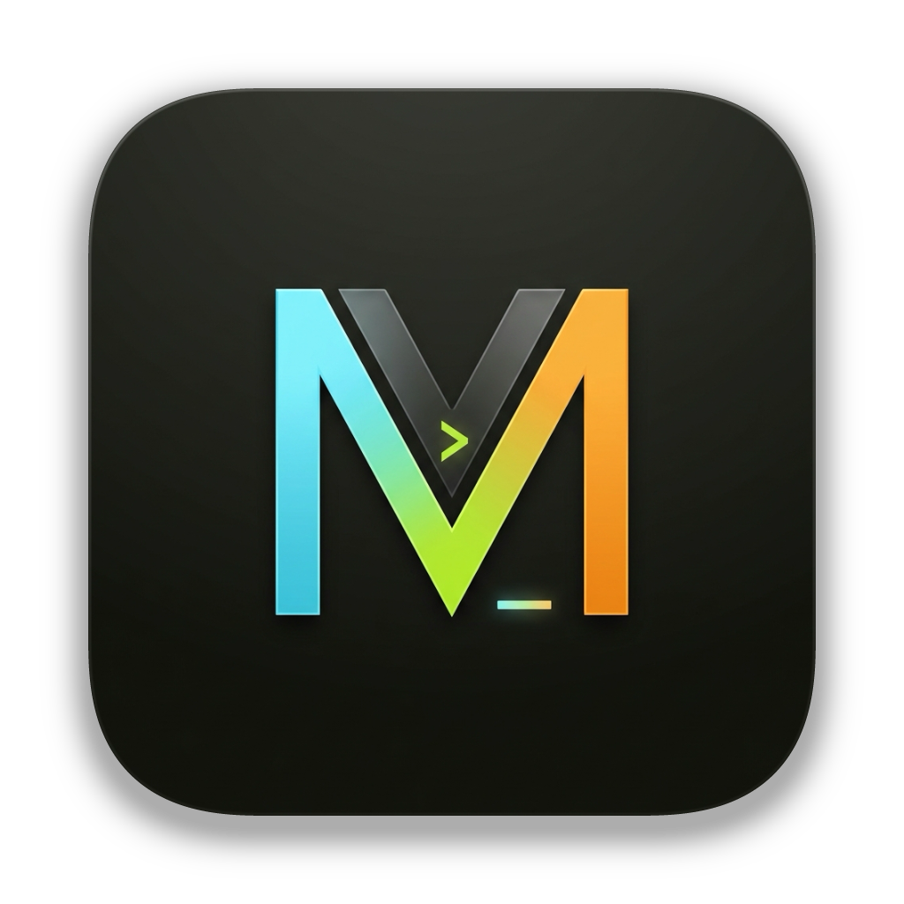

<p align="center">
  
</p>

# MultiplexIDE

A macOS all-in-one multi-environment developer workspace that unifies **Sublime Text 3** aesthetics & speed, **cmux**-style multi-environment split terminals with automatic reconnect, **cross-environment global search & Goto Anything**, and **agentless SSH/SFTP drag-and-drop file transfer**.

## Features

- **Multi-Environment Workspaces (`Local` + SSH)**: Manage local and multiple remote SSH targets inside one window (`⌘ 1` .. `⌘ 9` instant switch, zero scrollback loss).
- **Agentless OpenSSH `ControlMaster` Multiplexing**: Reuses macOS OpenSSH (`~/.ssh/config`, `ProxyJump`, `ProxyCommand`, 2FA/SSO/certificates) — no remote daemon installation required.
- **cmux-Style Resilient Multi-Tab Terminal**:
  - **Multi-Tab Terminals per Workspace**: Open unlimited terminal tabs per environment (`⌘ ⇧ T`, `⌘ T`, or `+` button), switch via `⌘ ⇧ [` / `⌘ ⇧ ]`, double-click a tab to rename, and keep every tab's scrollback alive across tab & workspace switches.
  - Recursive horizontal/vertical split panes inside every tab (`⌘ \` / `⌘ ⇧ \`), crisp macOS native DOM `xterm.js` rendering, right-click Copy/Paste menu, full macOS system clipboard sync (`⌘ C` / `⌘ V` + **OSC 52** remote `tmux`/`vim` clipboard forwarding), and OSC 9/99/777 unread badges.
  - **Seamless Disconnect, Reconnect & Restart Recovery**: Preserves 100% of local xterm scrollback across disconnects, auto-reconnects with exponential backoff and macOS wake-from-sleep (`powerMonitor`), and automatically re-attaches remote `tmux` sessions that were active within the last 1 hour even after quitting and reopening the app.
- **Sublime Text 3-Inspired Editor (4K HiDPI-Ready)**:
  - Authentic **Monokai**, **Mariana**, and **Boxy Dark** themes, comfortable 4K-friendly typography (`editorFontSize: 15`, `terminalFontSize: 14`, live `⌘ +` / `⌘ -` / `⌘ 0` zoom), raised seamless tabs, dirty `●` indicator, Minimap, 1/2-column split (`⌥ ⌘ 1` / `⌥ ⌘ 2`), cross-environment file Diff, and classic ST3 shortcuts.
  - Enhanced non-LSP syntax highlighting for **C/C++/CUDA** and **Python** (functions, namespaces, STL/typing types, `self`/`this`, `@decorators`, `#include`, f-strings, magic dunders, `TODO` tags).
- **Fast Multi-Environment Search (`⌘ ⇧ F`) & Goto Files (`⌘ P`)**:
  - Server-side `rg --files -L` (follows symlinks, handles huge monorepos without truncation) + `file:line` jump.
  - Streaming multi-environment `rg --json` (with `grep -rnI` fallback) and editable `Where:` path bar.
- **Cross-Environment File Tree & Drag-and-Drop Transfer**:
  - Drop from Finder onto any folder or workspace to upload.
  - **Dual Tree / Transfer Mode** to drag files/folders directly between `Local ↔ SSH` or `SSH-A ↔ SSH-B` over streaming SFTP pipes.
  - Hold **`⌥ (Option) + Drag`** on remote files to drag directly to Finder, or right-click `Download to Mac...`.

## Local Workspace Configuration (Not Committed to Git)

MultiplexIDE never stores personal hosts in the repository. On startup, it loads configuration from the first local path found:

1. `MULTIPLEX_CONFIG_PATH` environment variable (if set)
2. `./multiplex.local.json` in the project directory (**gitignored** — ideal for local development)
3. `~/.config/multiplex-ide/config.json` (auto-created on first launch with `Local` only)

To configure your own SSH environments locally:

```bash
cp multiplex.config.example.json multiplex.local.json
```

Or press **`⌘ ,`** inside the app to edit your active config JSON directly in an editor tab — pressing **`⌘ S`** hot-reloads workspaces and theme immediately.

See [multiplex.config.example.json](multiplex.config.example.json) for all supported fields (`theme`, `editorFontSize`, `terminalFontSize`, `showAllSshConfigHosts`, `extraPathDirs`, and `workspaces`).

## Development & Packaging (macOS)

```bash
# Install dependencies (rebuilds node-pty for Electron)
npm install

# Run in development mode
npm run dev

# Typecheck + unit tests + production build
npm run typecheck && npm test && npm run build

# Package macOS .app / .dmg into dist/
npm run package:mac
```

## Shortcuts

| Shortcut | Action |
| :--- | :--- |
| `⌘ ,` | Open active config JSON in editor (`⌘ S` hot-reloads) |
| `⌘ 1` .. `⌘ 9` | Switch workspace |
| `⌥ ⌘ ←` / `⌥ ⌘ →` | Switch previous / next editor tab |
| `⌘ P` | Goto Anything (supports `path:line` & multi-workspace toggle) |
| `⌘ ⇧ F` | Find in Files across one or multiple environments |
| `⌘ ⇧ T` (or `⌘ T` in terminal) | Open new terminal tab in active workspace |
| `⌘ ⇧ [` / `⌘ ⇧ ]` | Switch previous / next terminal tab |
| `⌘ \` / `⌘ ⇧ \` | Split active terminal horizontally / vertically |
| `⌘ +` / `⌘ -` / `⌘ 0` | Increase / decrease / reset editor & terminal font sizes |
| `⌥ ⌘ 1` / `⌥ ⌘ 2` | Single / 2-column editor layout |
| `⌘ B` / `⌘ J` | Toggle sidebar / terminal panel |
| `⌘ S` / `⌘ W` | Save current file / close current editor tab or terminal pane |
| `⌘ D` / `⌘ ⇧ D` / `⌘ L` / `⌘ ⇧ K` | Select next occurrence / duplicate line / select line / delete line |

## License & Third-Party Notices

MultiplexIDE is released under the [MIT License](LICENSE).

All bundled runtime dependencies (including Electron, Monaco Editor, xterm.js, node-pty, Allotment, React, Zustand, Lucide Icons, ssh-config, and ssh2-streams) use permissive MIT / ISC / BSD / Unlicense licenses that are fully compatible with MIT. Full verbatim copyright notices and license texts are provided in [THIRD_PARTY_NOTICES.md](THIRD_PARTY_NOTICES.md) and bundled into packaged macOS builds.

Verify or regenerate license notices after dependency changes:

```bash
npm run licenses:check
npm run licenses:generate
```

> **Trademarks**: MultiplexIDE is an independent open-source project and is not affiliated with Sublime HQ Pty Ltd (Sublime Text), Microsoft Corporation (VS Code), or Manaflow AI (cmux).
